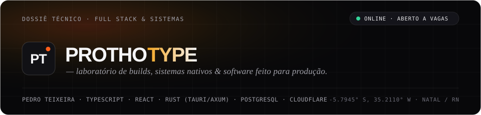

<p align="center">
  <a href="https://prothotype-portfolio.vercel.app">
    
  </a>
</p>

<p align="center">
  <a href="https://prothotype-portfolio.vercel.app"><strong>Portfólio</strong></a>
  &nbsp;·&nbsp;
  <a href="https://prothotype-portfolio.vercel.app/lab"><strong>PROTHOTYPE Lab</strong></a>
  &nbsp;·&nbsp;
  <a href="https://www.linkedin.com/in/pedrocartneto"><strong>LinkedIn</strong></a>
  &nbsp;·&nbsp;
  <a href="mailto:pedroteixeiraneto20@gmail.com"><strong>E-mail</strong></a>
</p>

---

E aí — sou o **Pedro Teixeira** (`PROTHOTYPE`).

De dia, coordeno suporte, manutenção e infraestrutura de TI na **Secretaria Municipal de Educação de Touros/RN** mantendo a secretaria e mais de **30 escolas municipais** de pé. No resto do tempo, construo software que eu mesmo queria que existisse: **leve, rápido, sem paywall bobo e sem comer metade da RAM no fundo**.

Não curto fazer protótipo bonito só pra print — se nasce uma dor real, eu coloco no ar, testo em produção e vou polindo até virar ferramenta de verdade.

```text
prothotype/
├── cafofo/              # Voz, chat, tela e música com a galera — Tauri v2 + Rust + React + Cloudflare
├── prisma/              # Gestão interna multiplataforma (15 setores reais na SMEC Touros · Postgres + RLS)
├── monolith/            # Ilha dinâmica pro Windows 11 em Python + PyQt6 (< 25 MB RAM · zero Electron)
├── gpu-hunter-br/       # Radar de hardware + agentes de IA em loop local 0-tokens
└── portfolio/           # Dossiê técnico + PROTHOTYPE Lab com simuladores interativos no navegador
```

---

## O que está rodando no laboratório

| Projeto | A dor que resolve | Stack | Onde ver |
| :--- | :--- | :--- | :--- |
| **[Cafofo](https://github.com/PROTHOTYPE/cafofo)** | Um lugar leve pra colar em call de madrugada, transmitir o jogo em 16:9 e ouvir música junto — sem cliente pesado comendo CPU. | `TypeScript` · `React` · `Rust` · `Tauri v2` · `Axum` · `PostgreSQL` · `Supabase` · `Cloudflare Pages/R2` | [Repositório](https://github.com/PROTHOTYPE/cafofo) · [Web App](https://cafofo.pages.dev) |
| **[PRISMA](https://github.com/PROTHOTYPE/sistema-smec-touros)** | Sistema independente de gestão de eficiência interna validado em produção na SMEC Touros — segurança no banco com RLS, não só na UI. | `TypeScript` · `React` · `Expo` · `PostgreSQL` · `Supabase` · `AsyncStorage` | [Case Técnico](https://prothotype-portfolio.vercel.app) · [Apresentação](https://sistema-smec-touros.vercel.app/apresentacao) |
| **[Monolith](https://github.com/PROTHOTYPE/dynamic-island-windows)** | Ilha dinâmica para Windows 11 com visual preto OLED que fica quieta no topo da tela até você precisar dela — sem Electron nem WebView. | `Python` · `PyQt6` · `Win32 APIs` | [Simulador & Capturas](https://prothotype-portfolio.vercel.app/lab) |
| **GPU Hunter BR** | Monitoramento estruturado de preços e specs de hardware com orquestração pragmática de agentes de IA e controle de custos. | `Python` · `Agentes IA` · `Scraping` | [Lab](https://prothotype-portfolio.vercel.app/lab) |
| **[Portfólio + Lab](https://github.com/PROTHOTYPE/portfolio)** | Duas rotas: um dossiê direto ao ponto para recrutadores e o `/lab` pra brincar direto com os projetos sem instalar nada. | `Next.js` · `TypeScript` · `React` | [Repositório](https://github.com/PROTHOTYPE/portfolio) · [Online](https://prothotype-portfolio.vercel.app) |

---

## Por baixo do capô

| Camada | O que eu uso no dia a dia |
| :--- | :--- |
| **Front-end & Mobile** | TypeScript, JavaScript, React, Next.js, React Native / Expo, HTML, CSS |
| **Back-end & Desktop** | Rust (`Tauri v2`, `Axum`), Node.js, Java, APIs REST |
| **Banco & Nuvem** | SQL / PostgreSQL (`PLpgSQL`, RLS, migrations), Supabase, Cloudflare Pages, Cloudflare R2, AsyncStorage |
| **Infra & Sustentação** | Terminal Linux, leitura de logs, Git, redes, suporte técnico em produção (N1/N2/N3), manutenção de hardware |
| **Automação & IA** | Arquitetura humana × agentes de IA para automações locais, scripts em Python e validação |

---

## Além do GitHub

- **SMEC Touros (`Fev/2024 — Atual`):** Coordenador de Suporte, Manutenção e TI — infraestrutura de +30 escolas, projeto de conectividade municipal (meta 100% online), entrega de laboratórios de informática e capacitação de professores de salas maker em programação básica, eletrônica e manutenção.
- **UFRN (`2021 — 2026 · Matrícula trancada`):** Bacharelado em Ciências e Tecnologia e Engenharia de Computação.
- **Idiomas:** Português (nativo) · Inglês intermediário (foco em leitura técnica e comunicação escrita).

---

<p align="center">
  <strong>Vamos construir algo de verdade?</strong><br />
  Achou algum projeto legal, quer trocar uma ideia técnica ou falar sobre uma vaga (Remoto, Híbrido ou Presencial no Brasil)?<br />
  Fica à vontade pra chamar no <a href="https://www.linkedin.com/in/pedrocartneto">LinkedIn</a> ou mandar um <a href="mailto:pedroteixeiraneto20@gmail.com">e-mail</a>.
</p>
<!--
**PROTHOTYPE/PROTHOTYPE** is a ✨ _special_ ✨ repository because its `README.md` (this file) appears on your GitHub profile.

Here are some ideas to get you started:

- 🔭 I’m currently working on ...
- 🌱 I’m currently learning ...
- 👯 I’m looking to collaborate on ...
- 🤔 I’m looking for help with ...
- 💬 Ask me about ...
- 📫 How to reach me: ...
- 😄 Pronouns: ...
- ⚡ Fun fact: ...
-->
